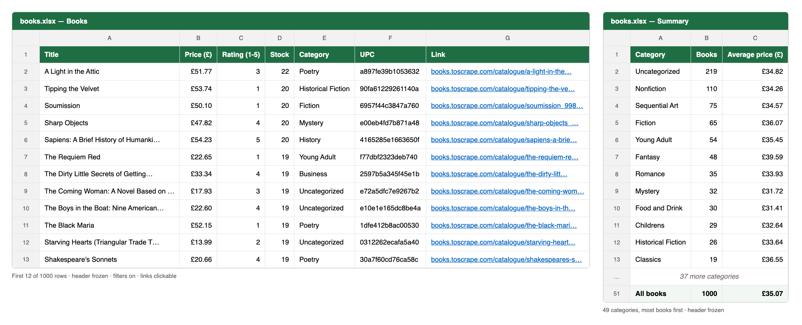

# Book scraper

Scrapes every book on [books.toscrape.com](https://books.toscrape.com), a practice site built for scraping, and saves the results to **CSV** and **Excel (.xlsx)**. It also compares prices with the previous run and writes a report of any changes.

A full scrape of all 1,000 books takes about **80 seconds** (it used to take almost 11 minutes), and about **11 seconds** on a re-run thanks to the cache.

For each book it collects:

| Field | Example |
|---|---|
| Title | A Light in the Attic |
| Price (£) | 51.77 |
| Rating (1–5) | 3 |
| Stock | 22 |
| Category | Poetry |
| UPC | a897fe39b1053632 |
| Link | https://books.toscrape.com/catalogue/a-light-in-the-attic_1000/index.html |



*The first rows of the `Books` sheet and the `Summary` sheet in `books.xlsx`. Long titles and links are shortened in this image only; the file holds them in full.*

## Features

- **Every book, in detail.** It reads the 50 catalogue pages, then visits each book's own page for the exact stock count, category and UPC.
- **Fast.** Pages are downloaded 8 at a time (`--workers`) over one shared connection pool, with a progress bar showing how far along it is.
- **Cache.** Each book's page is saved in `.cache/`. Re-runs read it from there instead of downloading it again. Use `--no-cache` to download everything fresh. Catalogue pages (which hold the prices) are always downloaded fresh, so price tracking stays accurate.
- **Clean categories.** The site files 219 books under placeholder categories called "Add a comment" and "Default". Both are shown as **Uncategorized**.
- **CSV and Excel.** Prices always have 2 decimals. The Excel file has a bold, coloured, frozen header row, filters, £-formatted prices, clickable links and columns sized to fit.
- **Summary sheet.** A second sheet lists each category with its book count and average price (£, 2 decimals), largest category first, with a total row at the bottom. Its header is bold and frozen like the main sheet.
- **Price changes.** Each run saves prices to `last_prices.json`. The next run compares against it and writes `price_changes.csv` (old price, new price, difference). Books are matched by UPC.
- **Keeps going when a request fails.** Each request is retried up to 3 times with increasing waits. Pages that still fail get one more, slower try at the end. If that fails too, a catalogue page is skipped, or a book keeps blank stock, category and UPC. Failures are listed at the end and the script exits with code 1 so automated jobs notice.
- **Polite.** Each worker waits 0.5 s before every request (adjust with `--delay`), so the site sees at most about 12 requests a second.
- **Logs.** Progress and errors go to the screen and to `scrape.log`.

## Speed: before vs after

Both are full scrapes of all 1,000 books (about 1,050 requests) with the same 0.5 s delay.

| Version | Time |
|---|---|
| Before: one page at a time | 10 min 43 s |
| After: 8 at a time, `--no-cache` | 80 s (about 8× faster) |
| After: re-run using the cache | 11 s |

## Setup

Requires Python 3.9+.

```bash
python3 -m venv .venv
source .venv/bin/activate        # Windows: .venv\Scripts\activate
pip install -r requirements.txt
```

## Usage

```bash
python scrape_books.py                      # all books -> books.csv + books.xlsx
python scrape_books.py --no-cache           # ignore the cache, download everything again
python scrape_books.py --pages 5            # first 5 catalogue pages (100 books) only
python scrape_books.py -o results           # -> results.csv + results.xlsx
python scrape_books.py -f xlsx -o report    # Excel only -> report.xlsx
python scrape_books.py --help               # list all options
```

| Option | Default | What it does |
|---|---|---|
| `-o`, `--output` | `books` | Output file name (the extension is added for you) |
| `-f`, `--format` | `both` | `csv`, `xlsx` or `both` |
| `-p`, `--pages` | all | Scrape only the first N catalogue pages |
| `-w`, `--workers` | `8` | Pages downloaded at the same time |
| `--delay` | `0.5` | Seconds each worker waits before a request |
| `--retries` | `3` | Retries per request before giving up on it |
| `--cache-dir` | `.cache` | Folder for cached book pages |
| `--no-cache` | off | Ignore cached pages and download everything again |
| `--history` | `last_prices.json` | Prices from the previous run |
| `--changes` | `price_changes.csv` | Where to write the price-changes report |
| `--log-file` | `scrape.log` | Where to write the log |

## Price changes

The first run has nothing to compare against, so it only saves `last_prices.json`. Every later run writes `price_changes.csv`:

```
title,upc,old_price_gbp,new_price_gbp,change_gbp,url
A Light in the Attic,a897fe39b1053632,49.99,51.77,+1.78,https://books.toscrape.com/...
```

The file has just the header row when nothing changed. Prices on this practice site don't change, so expect an empty report unless the site is updated.

## Example log

```
2026-11-07 17:39:23 INFO    --no-cache: downloading every page fresh
2026-11-07 17:39:29 INFO    Catalogue: 1000 books from 50/50 pages
2026-11-07 17:40:43 INFO    Book pages: 1000 done, 0 from cache, 0 failed
2026-11-07 17:40:43 INFO    Saved books.csv
2026-11-07 17:40:43 INFO    Saved books.xlsx
2026-11-07 17:40:43 INFO    Price changes since last run: 0 (report: price_changes.csv). New books: 0.
2026-11-07 17:40:43 INFO    Done: 1000 books in 80.1 s.
```

When something fails:

```
ERROR   Page 3 failed, skipping: <reason>
ERROR   Detail page failed, leaving stock/category/UPC blank: <link> (<reason>)
WARNING 1 page(s) failed and were skipped: [3]
```

## Notes

- Stock counts come from the cache on re-runs. Run with `--no-cache` when you need current stock.
- `docs/screenshot.png` is a static image. Re-take it if you change the output columns.
- `graphify-out/`, `scrape.log` and `.cache/` are excluded from git (see `.gitignore`).
